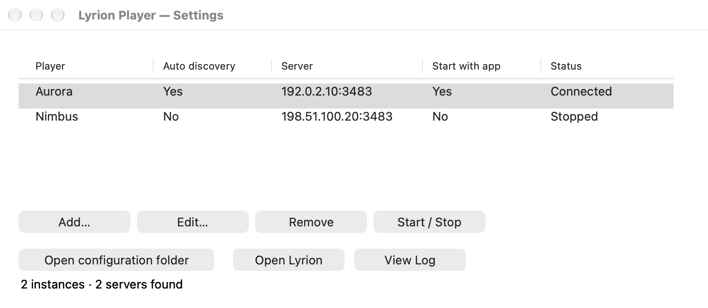

# Lyrion Player

A Lyrion Music Server player for macOS and Windows, based on
[Squeezelite](https://github.com/ralph-irving/squeezelite). Control it from Lyrion's
web interface or a compatible controller. Native macOS menu-bar and Windows
system-tray apps manage player instances without command-line configuration.
Player discovers the server on your
local network, or connects to a specified server.

Automatic discovery probes localhost (`127.0.0.1`), the general broadcast address,
and each active IPv4 LAN interface's subnet broadcast on UDP port 3483. LAN probes
use separate sockets bound to their interface's local address; on macOS they are
also pinned to that interface. For example, a Wi-Fi address of `192.168.1.144/24`
produces a probe to `192.168.1.255`. Interfaces are refreshed on each retry;
loopback and point-to-point VPN interfaces are excluded from the LAN list.
A server on the same Mac or PC can be found even without LAN access. The first valid reply
selects the server. In Configure player, choose a discovered server or Manual
address to select a particular server or use a nonstandard SlimProto port.

This improves discovery when a VPN changes the default broadcast route. It cannot
override VPN policies that block LAN traffic. If direct access works but broadcasts
remain filtered, select Manual address in Configure player and enter the server
host and port.

Player uses the signed-in user's **system default audio output**. Changing that
output while music is playing reroutes audio through Core Audio on macOS or WASAPI
on Windows. Playback stays connected to Lyrion; it does not restart the player or
the track. A brief gap while the operating system opens the new device is possible.
Shared mode lets other applications play audio too.

## Tray app

Requires macOS 13 or later (Apple Silicon or Intel), or Windows 10 or later (x64).
Build the app using the instructions below. Packaged builds include the backend
and codec libraries; users do not need Python, Homebrew, MacPorts, or vcpkg.



*Settings on macOS with fictional player names and example IP addresses.*

1. On macOS, copy **Lyrion Player.app** from the package into Applications and
   open it. On Windows, extract the entire package into a permanent folder and
   open **Lyrion Player.exe**, keeping `player.exe` and all DLLs beside it.
2. Open **Settings…** from the menu-bar/tray icon, then choose **Add…**. Enter a
   player name and select **Automatic**, a discovered server, or **Manual address**.
   The server list refreshes automatically at startup and 15 seconds after each
   scan completes. Manual addresses use a separate SlimProto port, normally `3483`.
   Automatic immediately displays the known server address in the read-only host
   field, and updates it when discovery completes. Saving keeps discovery enabled.
   Hover over the info icon beside each setting for a description.
3. Save, select the instance, and choose **Start / Stop**. Select this player in
   Lyrion and start music there. Repeat Add for additional instances/servers.
4. Enable **Start at login** in the tray menu to register the tray app once.
   It is off initially.
   **Start this instance with the app** controls which instances launch when the
   tray app opens, and is on for new instances.

**Only the tray app is registered at sign-in.** It owns the player child
processes; instances have no individual LaunchAgents, scheduled tasks, or Windows
services. Closing the Settings window keeps playback running. **Quit Lyrion
Player** stops every managed player before exiting. Sign-in startup runs in your
user session so playback follows the selected output device.

The tray menu provides Settings, a checked Start at login option, Start All,
Stop All, and Quit. Settings opens on the monitor where you click the tray icon.
Individual players and their connection/audio status appear
only in Settings. Select a player there to Start/Stop, Edit, View Log, or Open
Lyrion. These actions are greyed out when no player is selected. The read-only
Auto discovery column shows Yes for automatic instances; Server shows their
discovered IP and SlimProto port once known and stays blank until discovery
finds a server. Manual instances show No and their configured host and port.
Start with app shows Yes or No according to the instance’s saved startup
setting. Editing a running instance restarts only that instance. Unexpected
player exits retry after 1, 2 and 4 seconds; another failure within a minute
leaves that instance in Error until you start it again. Closing or crashing the
tray app cannot leave its players running independently.

Each instance gets a saved, unique MAC-style **Player ID**. Keep it unchanged to
preserve Lyrion's identity and settings. Use a different ID for every instance.
Automatic selects the first replying server; choose a discovered server or manual
address to keep an instance attached to a particular server. Discovered selections
save the server's current IP address. Use a stable hostname/manual address or
select it again if that address changes. Open Lyrion uses the discovered web port
(default `9000`); set the optional Web URL for a custom HTTPS/proxy address.

On macOS, Start at login uses `SMAppService`. If approval is required, enable
Lyrion Player in System Settings → General → Login Items. On Windows, it uses one
`LyrionPlayerTray` value in your own account's Run registry key. Put the app in its
permanent location before enabling startup. These are user-session registrations;
no administrator privileges are needed.

Configuration:

- macOS: `~/Library/Application Support/lyrion-player/config.json`.
- Windows: `%LOCALAPPDATA%\lyrion-player\config.json`.

Logs use `player-<instance ID>.log` in `~/Library/Logs/lyrion-player/` on macOS and
`%LOCALAPPDATA%\lyrion-player\` on Windows. Use View Log to open the selected
instance's file. Removing an instance retains its logs. Invalid configuration is
preserved and reported; Open configuration folder lets you locate it for repair.

## Build

Requires CMake 3.24+, C/C++ compilers (Objective-C++ on macOS), and the FLAC, Ogg/Vorbis, mpg123 and soxr
development libraries. Dependencies must be installed on machines running these
development builds. The Tray packaging step below copies runtime libraries
into a self-contained app/folder. If FLAC is missing, CMake can download and build FLAC 1.5.0; set
`-DPLAYER_FETCH_FLAC=OFF` to require installed libraries instead.

### macOS

Install Xcode Command Line Tools, then choose Homebrew or MacPorts for dependencies.
Apple Silicon and Intel builds use the same source.

With [Homebrew](https://brew.sh/):

```sh
brew install cmake flac libvorbis mpg123 libsoxr python
cmake -S . -B build -DCMAKE_BUILD_TYPE=Release -DPLAYER_BUILD_TRAY=ON
cmake --build build --parallel
ctest --test-dir build --output-on-failure
open "build/Lyrion Player.app"
```

With [MacPorts](https://www.macports.org/install.php):

```sh
sudo port selfupdate
sudo port install cmake flac libogg libvorbis mpg123 soxr python313
cmake -S . -B build -DCMAKE_BUILD_TYPE=Release -DPLAYER_BUILD_TRAY=ON \
  -DCMAKE_PREFIX_PATH=/opt/local \
  -DPython3_EXECUTABLE=/opt/local/bin/python3.13
cmake --build build --parallel
ctest --test-dir build --output-on-failure
open "build/Lyrion Player.app"
```

The MacPorts resampler port is named [`soxr`](https://ports.macports.org/port/soxr/).
The commands assume the default MacPorts prefix, `/opt/local`, and that
`/opt/local/bin` is on your `PATH`. Python is selected explicitly for the tests.
Use a fresh build directory when switching between Homebrew and MacPorts so CMake
does not reuse cached dependency paths.

### Windows

Use Visual Studio 2022 with Desktop development with C++, CMake, Python 3, and
[vcpkg](https://github.com/microsoft/vcpkg). In PowerShell, with `VCPKG_ROOT` set to
your vcpkg checkout:

```powershell
cmake -S . -B build -A x64 -DPLAYER_BUILD_TRAY=ON "-DCMAKE_TOOLCHAIN_FILE=$env:VCPKG_ROOT/scripts/buildsystems/vcpkg.cmake"
cmake --build build --config Release --parallel
ctest --test-dir build --build-config Release --output-on-failure
& ".\build\Release\Lyrion Player.exe"
```

The manifest installs codec dependencies. Keep the DLLs that vcpkg copies beside
`player.exe` with the executable if moving it to another directory.

### Create a self-contained package

On macOS:

```sh
cmake --install build --prefix "$PWD/build/package" --component Tray
open "build/package/Lyrion Player.app"
```

On Windows:

```powershell
cmake --install build --config Release --prefix "$PWD/build/package" --component Tray
& ".\build\package\Lyrion Player.exe"
```

Distribute the whole package with its licenses and corresponding source. The macOS
step bundles dylibs, fixes their paths and applies an ad-hoc signature. Developer
ID signing/notarization and Windows Authenticode signing require release credentials
and are not configured. These are unsigned development distributions for OS trust
purposes. CI builds separate macOS ARM64/Intel and Windows x64 ZIP artifacts.
Dependencies can set a higher minimum OS version than the app itself; use dependency
builds targeting your oldest supported OS when distributing broadly.

Python is only needed for tests.

## Playback

Native decoding: FLAC, MP3, Ogg Vorbis, and PCM (including WAV/AIFF). Other formats
require Lyrion transcoding. Optional AAC support requires faad2 and
`-DPLAYER_AAC=ON`. Direct HTTPS streams are not enabled in this initial build;
use the server's HTTP stream/proxy path. This is a stereo PCM player, with no DSD
passthrough or bit-perfect/exclusive output.

Decoded music is resampled using soxr to a stable 48 kHz, signed 32-bit stereo
stream. Miniaudio adapts that to the selected device's native format. Keeping a
stable software clock avoids changing Lyrion's stream capabilities when switching
between devices with different sample rates. Resampling defaults to soxr HQ.

If no usable device exists, Player remains connected to Lyrion and retries opening
the default output every two seconds. Buffered playback resumes when a device is
available. Long outages can affect synchronization with other players; no claim
of uninterrupted multiroom synchronization is made during device changes.
The device remains open and produces silence while paused or powered off in
Lyrion. Automatic log rotation and installer wizards are not included yet.

## Validation

`ctest` uses a separate `player_test_audio` executable with a silent backend. It
tests a SlimProto handshake against a local mock server, HTTP PCM streaming,
44.1-to-48 kHz resampling, an advancing playback clock, pause, and rejection of
fixed-device output. It also tests localhost discovery against an isolated mock
server without `--server`, including rejection of invalid discovery replies. Discovery
tests include replies received only on a separate source-bound interface socket.
They use a temporary port and simulated interface through test-only overrides;
production always probes
port 3483. Tests never play sound or connect to your real music server.
Broadcast calculation tests also cover different subnet sizes and reject masks
without a usable subnet broadcast. For a manual UDP-only check against real
servers, run `./build/player_discovery_test --probe`; it logs the interface probes
and first replying server without registering a player or playing audio.
Managed-mode tests verify JSON status, graceful stop, stdin EOF, and connected
shutdown against mock servers. Shared tray tests cover configuration, identities,
independent lifecycle, bounded restarts and compatibility with older configurations.
Native process tests exercise real inherited pipes, independent stop and force termination with the
silent backend. Native UI smoke tests create the settings/editor controls using a
temporary profile. Metadata discovery tests collect multiple mock replies. None of
these tests modify sign-in registrations.
A CI workflow builds/tests/packages the native apps on macOS and Windows.

Physical device switching requires manual validation on both systems:

1. Start a track in Lyrion; change the system output between speakers and a
   USB/Bluetooth device. Confirm audio moves and the same track remains active.
2. Switch while paused, then resume; confirm output uses the new default.
3. Disconnect the active output; reconnect it or select another output. Confirm
   recovery without restarting Player.
4. Switch between devices configured for different sample rates, skip tracks,
   adjust volume, and test sleep/wake.
5. Enable Start at login, sign out/in, verify configured players appear, then
   disable Start at login.

Hardware rerouting and real sign-in registration require manual verification on
each target system. See [architecture](docs/architecture.md) for the ownership and
recovery model.

## License and upstream

Player is GPL-3.0-or-later because it incorporates Squeezelite. Original copyright
notices are retained; the full GPL text is in [COPYING](COPYING).
See [third-party notices](THIRD_PARTY.md)
for pinned source revisions and local modifications. Miniaudio is used under its
MIT No Attribution option. Redistributing a build also requires satisfying its
codec libraries' licenses and supplying corresponding GPL source as applicable.
